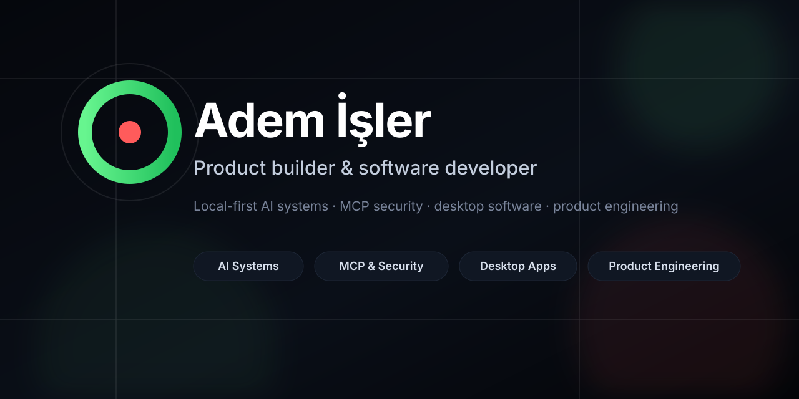

  

# hey, i'm adem.

**curious about a lot of things. making some of them real.**

I'm based in Le Havre, France. I like building useful things, exploring how technology works, and finding the overlap between software, design, and everyday problems.

Most of my public projects are **open-source tools, local-first apps, and experiments with AI**. The interesting part for me isn't just shipping a feature — it's figuring out what should exist, how it should work, and what makes it genuinely useful.

[website](https://ademisler.com) · [projects](https://ademisler.com/projects/) · [writing](https://ademisler.com/blog/)

## a few things i've made

| Project | The idea |
| :--- | :--- |
| **[RunOnMine](https://github.com/ademisler/RunOnMine)** | Give AI agents controlled access to your computer, with local permissions and approvals instead of blanket trust. |
| **[Myna Player](https://github.com/ademisler/Myna-Player)** | A video player that transcribes ahead and translates subtitles with context while keeping them in sync. |
| **[Toolboard](https://github.com/ademisler/toolboard)** | 80+ practical browser tools in one Chrome extension. |
| **[CodexControl](https://github.com/ademisler/codexcontrol)** | A local-first utility for tracking Codex quotas and switching accounts on macOS and Windows. |
| **[CodexPigeon](https://github.com/ademisler/codexpigeon)** | A repo-local mailbox for giving coding agents guidance at safe checkpoints. |
| **[Codex Desktop Custom Models](https://github.com/ademisler/codex-desktop-custom-models)** | Run an isolated Codex Desktop app with a custom model provider without changing your original setup. |

There are a few more experiments in my [repositories](https://github.com/ademisler?tab=repositories), including [Responsy](https://github.com/ademisler/responsy), [ContentAgent](https://github.com/ademisler/contentagent), and [SalesAgent](https://github.com/ademisler/salesagent).

## beyond the repos

I also work on web products, marketplaces, mobile apps, and commerce systems. Some are public; some are not open-source. You can find the bigger picture on [my projects page](https://ademisler.com/projects/).

Outside software, I'm drawn to film, visual art, storytelling, and whatever happens to catch my attention.

---

*useful before impressive. curious before certain.*
